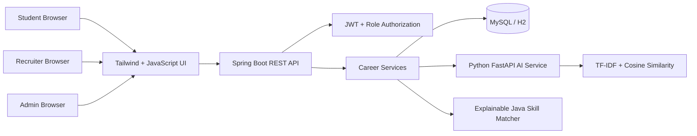
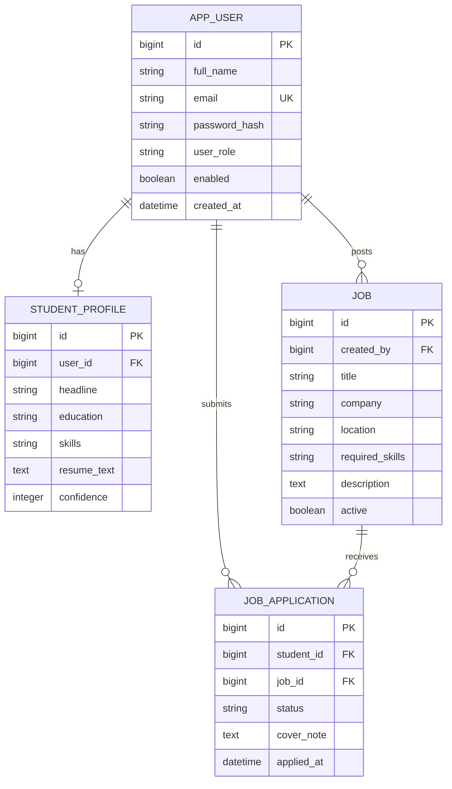

# Architecture & data design

## High-level architecture

The browser and REST API are served from the same Spring Boot application. The Python matching service is optional. If it is unavailable, the Java matching fallback keeps the core workflow available.

## Logical modules

- Identity: account registration, login, password hashing, JWT and role checks.
- Student profile: education, skills, resume text, links and confidence self-rating.
- Job management: recruiter-owned job creation, editing, closing and public listing.
- Applications: student submissions, duplicate prevention and recruiter status updates.
- Career intelligence: skill matching, readiness estimate, ATS-style feedback, risk signals and roadmap.
- Interview studio: role-based question prompts and structured practice feedback.
- Administration: platform-level counts and active-job overview.

## Database entities

The JPA model creates and updates tables for the demo. A production implementation should introduce Flyway/Liquibase migrations, explicit indexes and reviewed retention rules.

## Main application lifecycle

1. User registers or signs in. The API verifies the password hash and returns a signed JWT.
2. The browser sends the JWT with protected API requests.
3. The API resolves the current user and checks the user's role and ownership before privileged actions.
4. Students maintain their profile, explore open jobs and submit applications.
5. Recruiters manage their own postings and advance the status of applications received for those postings.
6. Career analysis compares a student's skills and resume text with active job requirements. TF-IDF matching is used when the Python service is online; otherwise the Java skill-coverage matcher runs.
7. The result includes matching signals, missing skills, resume suggestions, risk notes and a suggested learning sequence.

## Important design boundaries

- Match scores are relevance signals, not hiring probabilities.
- Resume/ATS feedback and interview feedback are heuristic demo features, not validated hiring assessments.
- Recruiter access is limited to applications for jobs they own. Admin has platform-wide aggregate access.
- A student can apply only once to a given job and can only see their own applications.
